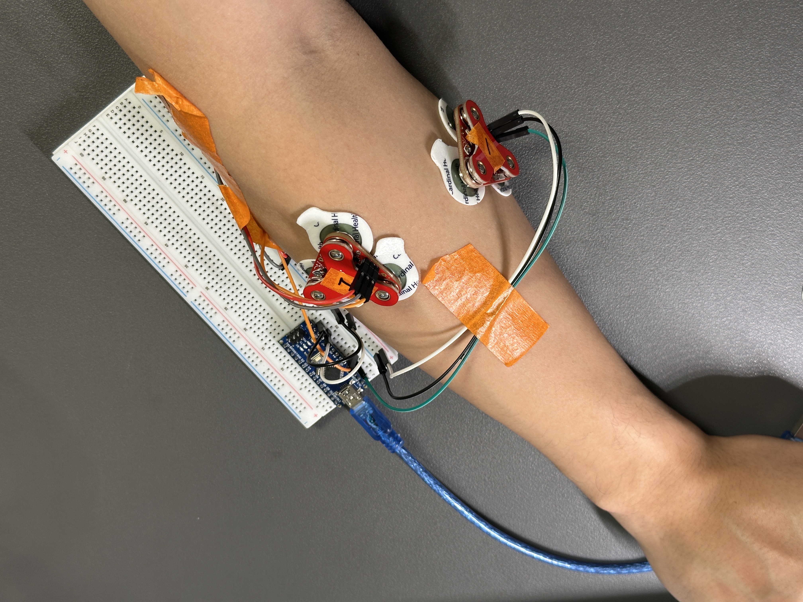

# 빌드로그 #6: MyoWare 1·2채널 첫 측정과 기초 인터랙션 (S1 6주차, 2026-11-02 \~ 11-05)

> V1 목표 "근육 신호 → 그리퍼 → 압력 → 진동" 중 **입력(sEMG)** 과 **압력→구동(FSR→서보)** 조각을 처음으로 실제 하드웨어에서 확인한 주.

## 이번 주 한 일

|날짜|한 일|결과|
|-|-|-|
|11-02|MyoWare(2) 1채널 ENV → Serial Plotter|쉼 22\~25, 최대 60\~450, 포화 없음|
|11-02|FSR → 서보 각도 매핑 (`sketches/fsr_servo`)|누르는 정도에 따라 0→180° 연속 이동|
|11-03|INA219 · MyoWare(1) 헤더 재작업|INA219 6/6, MyoWare(1) 3/3 통전, 브리지 없음|
|11-04|MyoWare 2채널 동시 관찰 (`sketches/myoware_2ch`)|굽힘엔 A0, 젖힘엔 A1만 크게 오름|

## 1\. MyoWare 1채널 (11-02)

* 전극: MID 이두 중앙 / END 팔꿈치 쪽 / REF 뼈, gain 가운데, 노트북 배터리 전원
* 쉼 22\~25 · 약하게 22\~44 · 최대 60\~450, 쉼 노이즈 ±1 LSB, 포화(1023) 없음

* **2세트 최대 140\~450, 3세트 60\~220** — 그 사이에 전극 위치를 바꿨더니 진폭이 절반 이하로 떨어졌다. 전극 위치가 값을 크게 좌우한다.

## 2\. FSR → 서보 (11-02)

* FSR 분압 → A0, `map(v, 20, 988, 0, 180)` + `constrain`, 3° 미만 변화 무시(떨림 방지), 서보 신호 D9, 서보 전원 AA×4, GND 공통
* 살짝 누르면 0° 근처, 최대로 누르면 180° 유지, 천천히 누르면 연속 이동(약한 떨림)
* **실수:** 처음에 FSR 분압 위쪽을 AA×4(약 6V)에 연결해 최대값이 1023에 붙었다. Nano 입력 한계(5V)를 넘을 수 있는 배선이라 Nano 5V로 옮겼고, 이후 최대 ≈980, 보드 이상 없음.

## 3\. 헤더 재작업 (11-03)

* 4주차 첫 납땜에서 헤더의 긴 쪽을 구멍에 넣는 실수 → 이번 주에 바른 방향으로 다시 땜

  * INA219: 칩 면 위, 긴 핀은 아랫면(브레드보드 쪽) → 6/6
  * MyoWare(1): 헤더 플라스틱은 스냅 반대면, 스냅 면에서 납땜·핀 끝 절단 → 3/3
* 상세: [notes/soldering.md](../notes/soldering.md)

## 4\. MyoWare 2채널 (11-04)

* A0 = MyoWare(1) 전완 안쪽 굴곡근(flex), A1 = MyoWare(2) 전완 바깥쪽 신전근(ext), 약 100Hz
* 측정표: [notes/myoware\_2ch.md](../notes/myoware_2ch.md)

|쉼|주먹 (두 채널 동시 수축)|
|-|-|
|||

* 굽힘 → flex만, 젖힘 → ext만 크게 오름(반대 채널은 쉼보다 10\~30 정도) → 2채널 분리 가능
* 주먹은 두 채널이 함께 오름
* Set 2 진폭이 Set 1의 2\~3배, 반복할수록 최대값이 줄어듦(피로·힘 차이로 추정)

## 배운 점

1. **전극 위치·피부 상태가 진폭을 바꾸기 때문에** 매 세션 시작 때 쉼·최대 수축을 다시 재는 보정 단계가 필요하다.
2. **센서 분압 전원은 MCU 전원(5V)에서** 가져와야한다. 서보 전원인 건전지(6V)과 섞으면 ADC 입력이 위험하다.
3. **헤더는 짧은 쪽을 보드에**, 긴 쪽은 꽂는 쪽(브레드보드·점퍼)으로. 납땜을 하기 전에 "이 핀이 나중에 어디에 꽂히는지"부터 잘 알아야 재작업률이 줄어든다.

## 다음 단계 (7주차\~)

* DSP 기초: 샘플링·에일리어싱, 이동평균·RMS 엔벨로프 → ENV에 이동평균 적용해 보기
* 예제 펌웨어(DRV2605L·Servo) 읽기
* 8주차: 그리퍼 STL 선정

